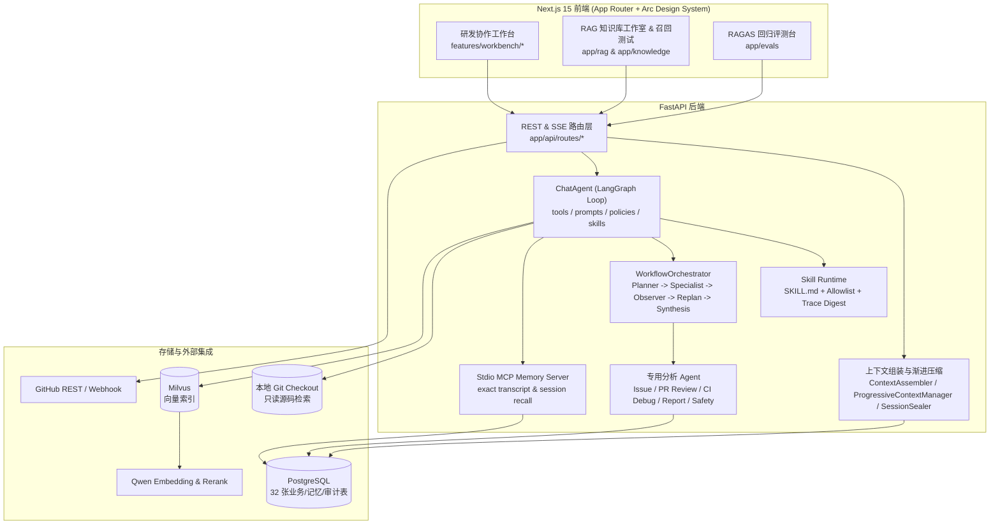
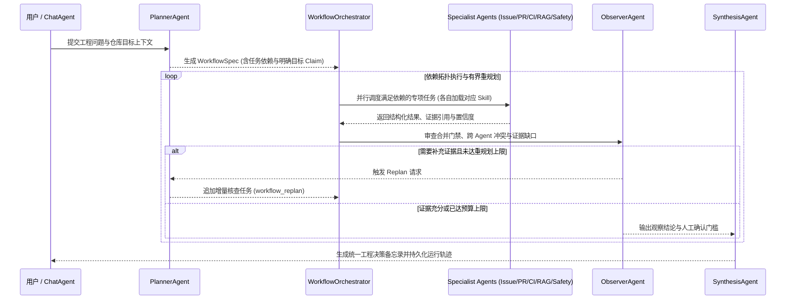

# DevHelm

[](https://github.com/Starchaser1024/DevHelm/actions/workflows/ci.yml)

DevHelm 是面向软件研发团队的全栈 AI 工程协作平台，连接真实 GitHub 仓库与本地代码工作区，围绕 Issue 分诊、PR 合入就绪度审查、CI 故障根因定位、项目知识图谱与长上下文工程对话提供可追溯、可评测、带安全护栏的智能体工作台。

## 核心架构与工程特性

- **原生工具调用对话引擎（`ChatAgent`）**：基于 LangGraph 状态机构建多步推理闭环（`model_decision -> tool_action -> observation`），内置重复调用指纹熔断、瞬时故障指数退避重试、轮内工具结果预算投影与供应商 Token 计量诊断。
- **多 Agent 协同工作流（`Planner -> Specialist -> Observer -> Replan -> Synthesis`）**：针对跨领域工程决策（如版本发布门禁、PR 合入就绪度），由 `PlannerAgent` 生成带明确目标声明（`Claim`）与依赖拓扑的 `WorkflowSpec`；`WorkflowOrchestrator` 并行调度就绪任务；`ObserverAgent` 校验合并门禁、跨 Agent 结论冲突与证据缺口，必要时触发有界重规划（`Replan`），最终由 `SynthesisAgent` 汇总决策备忘录并持久化 `AgentWorkflowRun` / `AgentTaskRun`。
- **`SKILL.md` 渐进式技能运行时（Skill Runtime）**：常驻提示词仅注入轻量技能目录摘要；命中显式指定或语义触发条件后才按需加载完整 `SKILL.md` 指令与受限参考资源。显式激活的 Skill 强制执行工具白名单（Tool Allowlist）契约校验，并将版本号、激活原因、指令 SHA-256 摘要与 `skill_validation` 结果写入事件轨迹。
- **分层上下文压缩与双轨记忆投影**：严格分离持久化完整转录（`MessageStore.timeline`）与模型活跃上下文视图（`MessageStore.recent`）。随上下文窗口压力递增，依次执行 Microcompact 旧工具输出裁剪、`ProgressiveContextManager` 多阶段摘要边界插入（保留关键事实与工作文件/工具 Rehydration 状态）以及 `SessionSealer` 会话封存；压缩后的任意历史原文仍可通过 MCP 只读工具（`devhelm_get_thread_context`、`devhelm_read_session_events`）按偏移量精确回查。
- **严格数据边界的混合 RAG（PostgreSQL + Milvus + Qwen Rerank）**：仅对跨来源复用的非结构化知识（Issue 描述、PR 讨论、脱敏失败 CI 日志、架构文档、上传资料、已确认长期记忆）建立向量与关键词双路索引；实时源码统一走 `workspace.*` 工作区词法/文件工具，实时状态与团队成员走关系库查询。对话采用“调用前 `ContextAssembler` 预检索 + 推理期 `rag.search_similar_documents` 查询改写与多轮交叉核验”的混合范式。
- **人机协同安全写护栏（`SafetyAgent` & `ActionDraft`）**：所有潜在外部写操作（创建 Issue、发布评论、外发周报）一律拦截为带风险分级与审计日志的 `ActionDraft`，必须经人工确认后方可执行，杜绝模型越权直接写回 GitHub。
- **双层自动化评测体系（Offline Eval + RAGAS 0.4）**：离线基准覆盖 Issue 分类、PR 风险覆盖率、RAG 召回命中率、工具 Schema 就绪度与结构化输出契约；在线基准在隔离会话中真实驱动生产 `ChatAgent`，基于 Ragas 0.4 计算五维语义与目标达成指标，支持异常评分单点重试与同基线 Hash 回归对比。

## 系统架构



### 多 Agent 工程审查闭环



## 目录与模块边界

```text
DevHelm/
├── backend/
│   ├── app/
│   │   ├── main.py                        # FastAPI 应用装配与 lifespan 生命周期管理
│   │   ├── core/                          # 配置管理 (Pydantic Settings)、日志与 Fernet 凭据加密
│   │   ├── db/
│   │   │   ├── models.py                  # SQLAlchemy 2.0 ORM 模型（仓库、会话、记忆、图谱、评测等 32 张表）
│   │   │   ├── session.py                 # 数据库引擎与请求级 Session 注入
│   │   │   └── bootstrap.py               # 本地快速起库兼容检查、默认会话回填与向量运行态探测
│   │   ├── api/routes/                    # HTTP / SSE 接口层（chat、issues、pull_requests、ci、rag、evaluations 等）
│   │   ├── services/
│   │   │   ├── agents/                    # Agent 编排层
│   │   │   │   ├── chat_agent.py          # ChatAgent LangGraph 主循环与流式事件分发
│   │   │   │   ├── chat_agent_tools.py    # 工具封装、参数归一化、重复调用熔断与异常分类重试
│   │   │   │   ├── chat_agent_prompts.py  # 系统提示词、轮内工具结果投影与 Token 计量诊断
│   │   │   │   ├── chat_agent_policies.py # 记忆路由策略、项目概览预取与无模型降级合成
│   │   │   │   ├── chat_agent_skills.py   # Skill 激活、工具白名单校验与评测轨迹采集
│   │   │   │   ├── workflow_orchestrator.py # Planner -> Specialist -> Observer -> Replan -> Synthesis 编排器
│   │   │   │   └── *_agent.py             # Planner / Observer / Synthesis / Issue / PR / CI / Report / Safety
│   │   │   ├── chat_runtime/              # 对话工具装配、工作区安全文件访问与工作流运行时构建
│   │   │   ├── chat_memory.py             # ContextAssembler 上下文预算组装入口
│   │   │   ├── memory_stores.py           # MessageStore 持久转录投影与 EvidenceStore 混合检索
│   │   │   ├── context_compaction.py      # ProgressiveContextManager 多阶段自动压缩与边界重水合
│   │   │   ├── session_sealing.py         # SessionSealer 会话封存与 MemoryTools 精确回查实现
│   │   │   ├── skills/                    # SKILL.md 解析、注册中心与触发器匹配
│   │   │   ├── rag/                       # 文档抽取、结构感知切片、Embedding、Milvus 检索、Rerank 与门控问答
│   │   │   └── evals/                     # 离线评测套件与生产 ChatAgent RAGAS 0.4 评测运行器
│   │   ├── mcp/memory_server.py           # 基于 stdio JSON-RPC 的只读记忆 MCP Server
│   │   ├── skills/                        # 内置 SKILL.md 技能包（pr-review、ci-debug、issue-triage 等）
│   │   └── tests/                         # 27 个测试模块（200+ 用例，内存 SQLite 隔离运行）
│   └── migrations/                        # Alembic 数据库结构演进脚本
├── frontend/
│   ├── app/                               # Next.js App Router 页面（工作台首页、仓库接入、RAG、周报、安全草稿、评测）
│   ├── features/workbench/                # 模块化研发协作工作台（状态控制器、流式分析 Hook、领域面板、知识图谱、弹窗）
│   ├── components/                        # Arc 设计系统组件、全局布局、错误边界与反馈控件
│   └── lib/                               # 类型定义、Fetch / SSE 流式客户端与统一错误映射
├── docs/                                  # 架构设计、API 说明、界面术语规范与工程手册示例
└── scripts/                               # 本地环境初始化、GitHub 同步与无外部依赖快速体验脚本
```

## 技术栈

- **后端**：Python 3.13、FastAPI、Pydantic v2、SQLAlchemy 2.0、Alembic、LangChain / LangGraph、PostgreSQL、Milvus、Ragas 0.4、httpx。
- **前端**：Next.js 15、React 19、TypeScript、Tailwind CSS、Arc 组件库。
- **基础设施**：Docker Compose（PostgreSQL + etcd + MinIO + Milvus）、GitHub Actions CI。

## 快速开始

### 1. 启动基础设施与后端

```bash
cp .env.example .env
docker compose up -d postgres etcd minio milvus

cd backend
python -m venv .venv
# Windows: .venv\Scripts\activate
# macOS / Linux: source .venv/bin/activate
pip install -r requirements.txt
alembic upgrade head
uvicorn app.main:app --reload
```

### 2. 启动前端

```bash
cd frontend
npm ci
npm run dev
```

默认访问地址：

- 前端工作台：`http://localhost:3000`
- 后端服务：`http://localhost:8000`
- 交互式 OpenAPI：`http://localhost:8000/docs`

### 3. 本地无外部依赖快速验证（可选）

如果希望在未启动 Docker / Milvus 或未配置 `LLM_API_KEY` 的环境下快速体验工作台界面、SQLite 存储、文档切片与关键词检索降级链路，可在 Windows PowerShell 执行：

```powershell
.\scripts\start_rag.ps1
```

该脚本显式使用 SQLite、`deterministic` 测试向量与启发式重排，并将向量状态标记为 `degraded`；已配置 `LLM_API_KEY` 时可附加 `-UseConfiguredLLM` 启用模型生成。完整混合检索与向量索引重建请使用 Docker Compose 启动 PostgreSQL 与 Milvus。

## 数据库迁移（Alembic）

表结构演进统一通过 Alembic 管理；`backend/app/db/bootstrap.py` 中的启动自检仅用于本地快速建表与历史本地库兼容补列。

```bash
cd backend
alembic upgrade head                         # 应用全部迁移
alembic revision --autogenerate -m "描述"     # 修改 ORM 模型后生成迁移脚本
alembic check                                # 校验模型与数据库是否存在漂移
```

- 数据库连接串由 `migrations/env.py` 从应用配置动态注入（环境变量优先于 `.env`）。
- `alembic.ini` 在 Windows 下按本地编码读取，请保持纯 ASCII 内容。

## 混合 RAG 与知识边界

系统内置端到端知识工程管线：知识库配置、多格式文档抽取（TXT / Markdown / PDF / DOCX / JSON / CSV / 日志，按 SHA-256 幂等去重）、标题与段落感知切片、Embedding、向量 + 关键词混合召回、Qwen Rerank 重排、召回测试台与编号证据引用。

- **私域数据分流原则**：只有跨任务复用的非结构化知识进入向量库；当前分支源码与配置文件以本地 Git Checkout 为权威来源，通过 `workspace.list_files`、`workspace.read_file`、`workspace.search_code` 实时读取；Issue / PR / CI 状态字段与团队成员直接查询关系库。
- **Embedding 与 Rerank 配置**：默认支持本地 `Qwen/Qwen3-Embedding-0.6B`（安装 `backend/requirements-local-embedding.txt`）或兼容 OpenAI / 百炼接口的远程 Embedding 与 `qwen3-rerank`。生产配置下若 Embedding 依赖缺失会显式报错，绝不静默混用异构向量空间。
- **索引重建**：升级切片策略或知识边界后，可调用 `POST /api/rag/{repo_id}/reindex` 清理旧文档并重建当前仓库索引。

核心 RAG 接口：

```text
POST /api/rag/knowledge-bases
GET  /api/rag/knowledge-bases
GET  /api/rag/knowledge-bases/{repo_id}
POST /api/rag/knowledge-bases/{repo_id}/documents
POST /api/rag/knowledge-bases/{repo_id}/retrieval-tests
GET  /api/rag/{repo_id}/status
POST /api/rag/{repo_id}/search
POST /api/rag/{repo_id}/ask
POST /api/rag/{repo_id}/reindex
```

## 评测体系（Offline Suite & RAGAS 0.4）

访问 `http://localhost:3000/evals` 可在页面发起并追踪评测任务，也可通过 API 调用：

- **离线确定性评测（`POST /api/evals/run`）**：无需外部 Judge 即可验证 Issue 分类准确率、PR 风险覆盖度、RAG 召回率、工具 Schema 完整性与结构化输出校验。
- **生产链路 RAGAS 评测（`POST /api/evals/rag/run`）**：后台异步在隔离会话中真实运行 `ChatAgent` 与工具链，采集预检索与二次检索证据，基于 Ragas 0.4 Collections API 评估 `Context Precision`、`Context Recall`、`Faithfulness`、`Answer Relevancy` 与 `Agent Goal Accuracy`。
- **可诊断与可回归**：评测页面严格区分“执行异常（Judge 超时/指标缺失，支持单点重试异常评分）”与“质量未达标（低于 `RAGAS_*_MIN` 阈值）”，支持按相同评测集 SHA-256 与 Top-K 进行历史版本回归对比，并可将失败用例一键生成待人工确认的 `create_issue` 安全草稿。

## 质量校验与测试

```bash
# 后端单元测试与集成测试（内存 SQLite 隔离运行）
cd backend
pytest -q

# 前端类型检查、ESLint 与生产构建验证
cd frontend
npx tsc --noEmit
npm run lint
npm run build
```

## 界面术语与更多文档

- 界面文案以中文为主，`Issue`、`PR`、`CI`、`Agent`、`Skill`、`MCP`、`RAG`、`Token` 等核心领域专名保留英文，详见 [docs/terminology.md](docs/terminology.md)。
- 架构与安全设计：[docs/architecture/system_design.md](docs/architecture/system_design.md)、[docs/architecture/agent_workflow.md](docs/architecture/agent_workflow.md)、[docs/architecture/database_schema.md](docs/architecture/database_schema.md)、[docs/architecture/security.md](docs/architecture/security.md)。
- 接口概览与工程手册示例：[docs/api/openapi.md](docs/api/openapi.md)、[docs/examples/incident_and_release_runbook.md](docs/examples/incident_and_release_runbook.md)。
